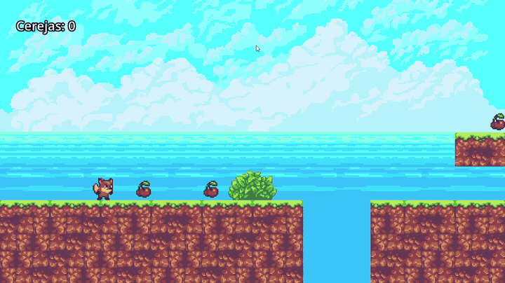

# Jogo da Raposa

Jogo de plataforma 2D feito na Godot. A raposa percorre uma fase, coleta cerejas e usa um dash para avançar pelos obstáculos; também é possível derrotar o inimigo ao pular sobre ele. O jogo inclui menu, pausa e reinício após situações de perigo.

[](https://godotengine.org/)
[](https://docs.godotengine.org/en/stable/tutorials/scripting/gdscript/)

## Prévia

O repositório contém uma imagem de referência visual da fase:




## Funcionalidades

- Menu inicial com opções para iniciar a fase ou sair do jogo.
- Movimento horizontal e salto.
- Coleta de cerejas, com pontuação exibida no HUD.
- Power-up que habilita o dash, acionado pelo teclado.
- Inimigo que patrulha a fase; tocar nele pelas laterais reinicia a partida, enquanto pular sobre ele o derrota.
- Mensagem no HUD ao adquirir o dash, com a instrução para acioná-lo.
- Zona de queda que reinicia a fase após uma breve pausa.
- Menu de pausa com opções para continuar ou voltar ao menu principal.
- Placa que mostra uma mensagem ao jogador quando ele se aproxima.

## Controles

| Ação | Tecla |
| --- | --- |
| Mover para a esquerda / direita | `A` / `D` |
| Pular | `Espaço` ou `↑` |
| Pausar / continuar | `Esc` |
| Dash | `Shift` (depois de coletar o power-up) |

## Tecnologias

- **Engine:** Godot 4.7
- **Linguagem:** GDScript
- **Cenas e recursos:** formatos nativos da Godot (`.tscn` e `.tres`)

Não foram identificados serviços externos, APIs, banco de dados ou dependências adicionais de aplicação.

## Organização do projeto

| Caminho | Responsabilidade |
| --- | --- |
| `project.godot` | Configura o projeto, define o menu inicial, ações de entrada e o autoload do jogo. |
| `scenes/` | Cenas do menu, fase, jogador, inimigo, HUD, itens e menus. |
| `scripts/` | Lógica de movimento, pontuação, coleta, inimigo, menus e zonas de colisão. |
| `resources/` | Recursos reutilizáveis, incluindo o tileset do terreno. |
| `artes/` | Imagens e animações usadas nos cenários, personagens, itens e efeitos. |

O `GameManager` é um autoload que mantém a pontuação e emite um sinal para atualizar o HUD. A fase (`scenes/level.tscn`) reúne as cenas reutilizáveis de jogador, inimigo, cerejas, power-up, placa e menus.

## Como abrir e executar

### Pré-requisito

- [Godot Engine 4.7](https://godotengine.org/download/)

### Passos

1. Clone o repositório:

   ```bash
   git clone https://github.com/DiegoOLiveiraCamargo/JogoDaRaposa.git
   cd JogoDaRaposa
   ```

2. Abra o Gerenciador de Projetos da Godot, importe o arquivo `project.godot` deste diretório e abra o projeto.
3. O arquivo `project.godot` define o menu como cena principal; use **Executar projeto** (`F5`) no editor para iniciar o jogo por ele.

Não há variáveis de ambiente documentadas nem etapa separada de instalação de dependências. O repositório não contém configuração de exportação identificada.

## Créditos e colaboração

O histórico de commits registra contribuições atribuídas a **Diego Oliveira Camargo** e **Caio Oliveira**.

Os arquivos de arte estão no diretório `artes/`; a origem e as licenças dos pacotes gráficos não estão documentadas no projeto.

## Contato

- GitHub: [DiegoOLiveiraCamargo](https://github.com/DiegoOLiveiraCamargo)
- LinkedIn: [Diego Oliveira Camargo](https://www.linkedin.com/in/diegooliveiracamargo/)
